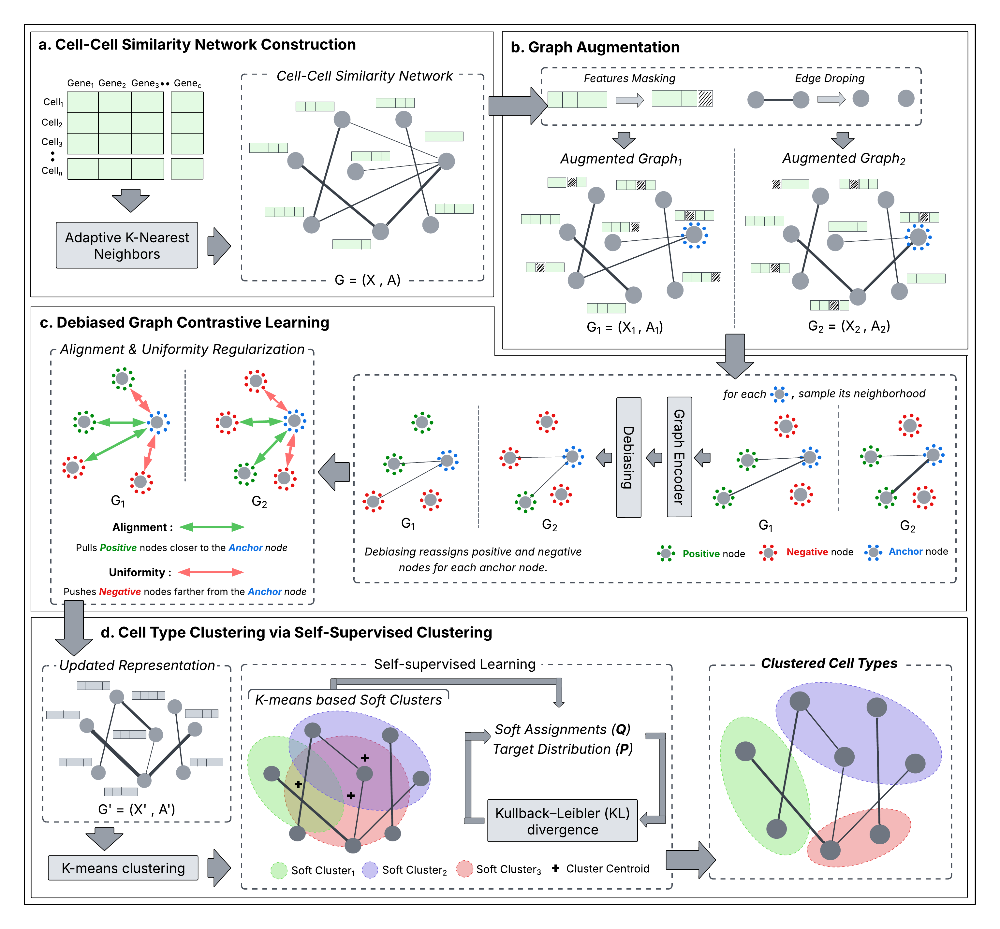

# scAURA: Alignment- and Uniformity-based Graph Debiased Contrastive Representation Architecture for Self-Supervised Clustering of Single-Cell Transcriptomics

scAURA is a self-supervised graph representation learning framework for clustering single-cell RNA sequencing (scRNA-seq) data. It constructs an adaptive cell-cell graph and uses a Graph Convolutional Network (GCN) to learn cell representations through debiased contrastive learning, alignment, and uniformity objectives. The learned representations are further refined using Deep Embedded Clustering (DEC) to identify cell populations.

## Architecture



*Figure 1. Overview of the scAURA framework, including adaptive graph construction, graph-based contrastive representation learning, and deep embedded clustering.*

## Running scAURA

Three implementations are provided depending on dataset size and available computational resources.

### Option 1: CPU version (small datasets)

Use this version when the dataset contains **fewer than 2,500 cells**.

```bash
python scAURA.py
```

### Option 2: GPU version (large datasets)

Use this version when the dataset contains **2,500 cells or more** and the entire dataset can fit into GPU memory.

```bash
python scAURA_gpu.py
```

### Option 3: GPU Mini-batch version (very large datasets)

Use this version for **very large datasets** or when the full dataset does not fit into GPU memory. This implementation performs **mini-batch training** for improved scalability and memory efficiency.

```bash
python scAURA_GPU_minibatch.py
```
